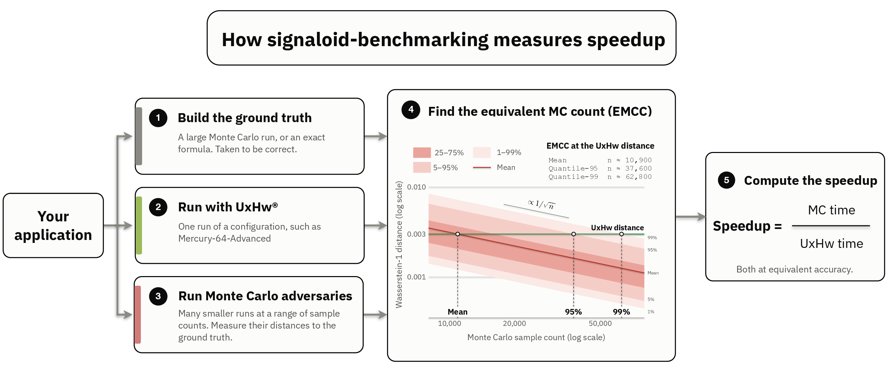

# Signaloid Benchmarking

This package provides tools for benchmarking applications that use Signaloid's UxHw® technology. This allows you to quantify the relative speedup of a program that utilizes Signaloid's distribution-extended compute capabilities compared to a reference method such as Monte Carlo.

The `signaloid_benchmarking` Python package builds on the
[Signaloid Data Toolkit](https://github.com/signaloid/signaloid-data-toolkit),
the `signaloid` package on PyPI. The benchmarking tool builds and runs an application natively and with UxHw, computes the equivalent Monte Carlo count of each UxHw configuration, collects timing data, and writes reports.



## Tools

This package contains the following tools:

| Command or function | Use it to | Guide |
|---|---|---|
| `signaloid-benchmarking` | Measure the equivalent Monte Carlo count and speedup of each UxHw configuration of an application. | [automation](src/signaloid_benchmarking/automation/README.md) |
| `signaloid-memory-profile` | Find the exact uncertain memory pool size that one UxHw run needs. | [profiling](src/signaloid_benchmarking/profiling/README.md) |
| `distance_uxhw_vs_mc` | Regression-test a new UxHw SDK build. It compares the accuracy of two runs of the same application against one ground truth. | [differential accuracy](src/signaloid_benchmarking/differential_accuracy/README.md) |
| `ks_convergence_gate` | Test for distributional convergence with a simple Kolmogorov-Smirnov (KS) gate. | [differential accuracy](src/signaloid_benchmarking/differential_accuracy/README.md#ks_convergence_gate) |

## How it works

UxHw's distribution-extended compute capabilities allow for the deterministic computation of quantities usually determined by stochastic methods such as Monte Carlo. Monte Carlo handles distributions by running a program numerous times with
random samples, whereas UxHw runs the program once.

This brings a challenge when comparing UxHw and Monte Carlo (MC) as MC inherently has variability and its answers will vary from run to run. Therefore, we can only compare the
accuracy of a UxHw run with the average accuracy of MC, or say that UxHw is as accurate as MC with a given confidence, for example 95%.

`signaloid_benchmarking` does the following for each output of an application.

1. It builds a **ground truth** for the application, a distribution deemed to be correct, or very close to correct. This is typically a large Monte Carlo run, or an exact formula.
2. It runs the application with UxHw, and measures the **distance** from the
   UxHw output to the ground truth. Distances metrics include Wasserstein family of distances.
3. It runs smaller Monte Carlo runs, the **adversaries**, at a range of
   sample counts, and measures their distances too.
4. It finds the **equivalent Monte Carlo count (EMCC)**. This is the smallest
   Monte Carlo sample count that has the same distance to the ground truth as UxHw. This can often be done by a central limit theorem (CLT).
5. It times the native Monte Carlo program at the EMCC, and divides that by
   the UxHw time. The result is the **speedup** at equal accuracy.

The tool repeats this for every UxHw configuration that you ask for. A UxHw configuration is a microarchitecture with a specified representation size and dependency tracking setting. Microarchitectures include Athens, Rome, Mercury, Jupiter, and Europa. The representation size is a measure of the fidelity of the underlying distributions, with larger representations incurring longer run times in exchange for better accuracy. All representation sizes must be powers of 2, from 16 to 512.

Athens and Rome have the option of basic dependency tracking or no dependency tracking (e.g., `Rome-64-Basic` or `Rome-64-None`). Mercury, Jupiter, and Europa all support advanced dependency tracking only (e.g., `Mercury-16-Advanced`).

## Supported platforms

| | Linux x86-64 | macOS |
|---|---|---|
| Install the package | Yes | Yes |
| `signaloid-benchmarking` and `signaloid-memory-profile` | Yes | No |
| `distance_uxhw_vs_mc`, `ks_convergence_gate`, and the Python library | Yes | Yes |

The package supports Python 3.11 and later. CI tests Python 3.11 to 3.15 on
Linux and macOS.

`signaloid-benchmarking` and `signaloid-memory-profile` build the
application with the Signaloid UxHw SDK. The SDK comes installed on the
Signaloid Computing Engine Amazon Machine Image (AMI).

The SDK picks the build of the UxHw core library that matches the CPU. On a
CPU with AVX-512, it uses the AVX-512 build. On any other x86-64 CPU, it
uses the baseline build, which is slower and runs in single precision.
Results from the two builds can differ, so run every benchmark that you
want to compare on the same kind of machine. To check a Linux machine, run
`grep -m1 -o avx512f /proc/cpuinfo`. It prints `avx512f` when the CPU has
AVX-512.

## Installation

The package is not on PyPI. Install it from GitHub with pip or Poetry.


### Choosing a Python version

The package supports Python 3.11, 3.12, 3.13, 3.14, and 3.15. Python 3.11 and later is recommended.

### With `pip`

Install into a virtual environment.
```bash
python -m venv .venv
source .venv/bin/activate
python -m pip install git+https://github.com/signaloid/signaloid-benchmarking
```

Add the `sheets` extra for the optional Google Sheets upload.
```bash
python -m pip install "signaloid-benchmarking[sheets] @ git+https://github.com/signaloid/signaloid-benchmarking"
```

To pin a branch, tag, or commit, add `@<ref>` to the end of the URL.

### With `poetry`

Add the package to your Poetry project. The project must use a supported
Python version.
```bash
poetry add git+https://github.com/signaloid/signaloid-benchmarking.git
```

Add `--extras sheets` for the optional Google Sheets upload. To pin a branch,
tag, or commit, add `#<ref>` to the end of the URL.
```bash
poetry add git+https://github.com/signaloid/signaloid-benchmarking.git#main --extras sheets
```

Run the tools through Poetry, so that you use the project's copy.
```bash
poetry run signaloid-benchmarking --help
```

### From a clone

Clone with `--recurse-submodules`, because the build templates are a git
submodule at `src/signaloid_benchmarking/assets`.
```bash
git clone --recurse-submodules https://github.com/signaloid/signaloid-benchmarking
cd signaloid-benchmarking
python3.13 -m venv .venv
source .venv/bin/activate
python -m pip install ".[sheets]"
```

If you cloned without `--recurse-submodules`, run
`git submodule update --init` before you install.

### Checking the install

Check that the command runs and that it lists the representation types you
expect.
```bash
signaloid-benchmarking --help
```

### Replacing an older copy

Installing replaces any older copy of `signaloid-benchmarking` in the same
environment. Each build adds its commit hash to its version, for example
`1.0.0+e8bf650`, so pip never mistakes one build for another.

If the command still behaves like an old version, another copy is probably
earlier on your `PATH`. List every copy, then uninstall the stale one with
the Python that it belongs to.
```bash
which -a signaloid-benchmarking
python -m pip uninstall signaloid-benchmarking
```

To be sure that you use the copy in the active Python environment, run the
tool as a module instead. It takes the same options.
```bash
python -m signaloid_benchmarking.automation --help
```

## Running a benchmark

This command runs the recommended Athens benchmark. Change the two paths to
your application and your UxHw SDK. Run it from an empty directory, because
the tool writes its results to the current directory.
```bash
mkdir ~/benchmark-run && cd ~/benchmark-run
signaloid-benchmarking \
    --path-to-application ~/my-application \
    --path-to-uxhw-sdk /opt/Signaloid-UxHw-SDK \
    -u Athens \
    -s 16 32 64 128 256 512 \
    -d None Basic \
    -r Mean Quantile-95 Quantile-99 \
    --ground-truth-type WeightedSamples \
    --ground-truth-size 2000000 \
    --max-num-weighted-samples 500000 \
    --adversary-mc-size 1000000 \
    --adversary-max-size-scalar 100000 \
    --num-adversaries 100 \
    --use-clt
```

A full run takes hours. The speedups end up in one Markdown report for each
output, in `results/`. The
[automation guide](src/signaloid_benchmarking/automation/README.md) covers
how to prepare an application, a public demo to try first, a quick test run,
the commands for the other representation types, and how to read the
results.

## Development

Install the package and its development dependencies with Poetry, then run
the checks that CI runs. Use a supported Python version, ideally 3.13.

```bash
poetry install --all-extras
poetry run flake8 src/
poetry run black --check src/
poetry run mypy -p signaloid_benchmarking
poetry run pytest
```

To develop with pip instead, install from a clone in editable mode, so that
your changes take effect without a reinstall. This skips the development
tools, such as `pytest` and `mypy`.
```bash
python -m pip install -e ".[sheets]"
```

The code is in `src/signaloid_benchmarking/`.

| Package | Contents |
|---|---|
| [`automation`](src/signaloid_benchmarking/automation/README.md) | The `signaloid-benchmarking` pipeline. |
| [`equivalent_mc`](src/signaloid_benchmarking/equivalent_mc/README.md) | The EMCC computation. |
| [`profiling`](src/signaloid_benchmarking/profiling/README.md) | `signaloid-memory-profile`. |
| [`differential_accuracy`](src/signaloid_benchmarking/differential_accuracy/README.md) | `distance_uxhw_vs_mc` and `ks_convergence_gate`. |
| `benchmark_timing` | The Bash timing and build scripts that the pipeline sources. |
| `distribution_helpers` | Helpers for collapsing, binning, and checking the health of distributions. |
| `configs` | The preset YAML files for `--config`. |
| `assets` | The build templates, a git submodule. |

The unit tests are `*_test.py` files next to the code they test. To run one
file, or one test, name it.
```bash
poetry run pytest src/signaloid_benchmarking/automation/report_writer_test.py
poetry run pytest src/signaloid_benchmarking/automation/report_writer_test.py -k blow_up
```
